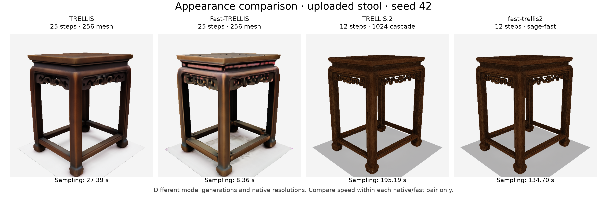
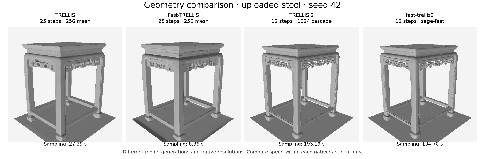
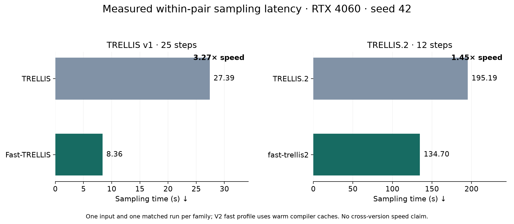

# Measured results

Release 0.2.0, measured 3 November 2026 on an NVIDIA RTX 4060 (8188 MiB),
Windows, Python 3.11.9, PyTorch 2.8.0+cu128, FlashAttention 2.8.3 and
SageAttention 2.2.0. The compatibility runtime loads stages separately to fit
8GB VRAM. These are measurements on the uploaded issue #4 stool, not a dataset
benchmark or a claim about the reporter's RTX 3090/SDPA environment.

## TRELLIS.2 paired results

All profiles share preprocessing, checkpoint revision, seed, guidance and the
12-step `1024_cascade` configuration. Timings use synchronized CUDA boundaries.
Fast results use warm compiler caches.

| Seed | Native sampling | `sage` sampling | `sage-fast` sampling | Native / fast generation | Fast Fscore@.005 | Fast base-color PSNR |
|---|---:|---:|---:|---:|---:|---:|
| 42 | 195.19s | 153.99s | 134.70s | 271.24 / 214.20s | 1.000000 | 32.46 dB |
| 43 | 199.36s | 156.44s | 135.27s | 289.67 / 224.02s | .999790 | 32.21 dB |

`sage-fast` delivers **1.45–1.47× sampling speed**: 45–47% faster throughput,
or 31–32% less sampling time. Generation time is 21–23% lower. Against the
earlier self-attention-only `sage`, sampling time falls another 12–14%.

The original aggressive cache took 58.37s sampling / 126.45s generation but
produced damaged geometry and textures (Fscore .359). It is not an equivalent
quality baseline. The release accelerates inference at near-native fidelity; it does not
recover the damaged cache's latency at native quality.

First-use compiled normalization took 60.2s in the profiled stage versus 39.0s
warm. This is a stage diagnostic, not a measured whole-process cold-start bound.
Model download, compilation, rendering and export can dominate a first request.

Fscore measures sampled **vertex reference fidelity**, not ground-truth surface
accuracy. PSNR uses six matched 60k-face proxy renders; even native repeat
decimation gives 33.25 dB in this setup. Near-one Fscore is not identical geometry.
PBR material differences remain: seed 42/43 shared-coordinate metallic RMSE is
.04630/.03902 and alpha RMSE .00943/.02305. See the
[full material diagnostics](../benchmarks/issue4/v2-materials.json) and
[method analysis](METHODS.md). Use `sage` when these deviations matter.

## Four-way comparison

Actual learned inference was also run with the original TRELLIS and upstream
Fast-TRELLIS. Both V1 variants share the same checkpoint, DINOv2 conditioning,
seed 42, 25 SS/SLaT steps and 256-grid mesh decoder. V2 uses its own larger model,
DINOv3 and 1024 cascade. **Compare speed within each native/fast pair.**

| Model | Sampling | Generation¹ | Raw faces | Fscore vs matched native |
|---|---:|---:|---:|---:|
| TRELLIS | 27.39s | 53.87s | 1,138,928 | reference |
| Fast-TRELLIS | 8.36s | 37.82s | 1,223,800 | .774298 |
| TRELLIS.2 | 195.19s | 271.24s | 11,051,238 | reference |
| fast-trellis2 `sage-fast` | 134.70s | 214.20s | 11,035,188 | 1.000000 |

¹ V1 generation includes loading, decoding and artifact saving, excludes cached
DINO conditioning. V2 generation includes stage loading and raw decoding,
excludes initial preprocessing, rendering and export. Totals have different
cross-generation scopes. One matched run is shown per family; no timing
confidence interval is implied. V2 has the second-seed check above.

Fast-TRELLIS is 3.27× faster in V1 sampling (69.5% less time), with visible color
changes and reduced reference fidelity on this image. That speed/quality tradeoff
does not establish that its cache assumptions transfer safely to TRELLIS.2.

All four meshes were rendered raw, without decimation, at 512px with six common
cameras. Appearance uses V1 vertex color and V2 volumetric base color; clay uses
common lighting. The figures show view 0. The release evidence bundle contains
all 48 PNGs, camera manifest, data and figure-building source. PNG/SVG/PDF figure
exports are in the [release evidence ZIP](https://github.com/Archerkattri/fast-trellis2/releases/download/v0.2.0/fast-trellis2-v0.2.0-evidence.zip).

## CLI validation

The release CLI completed actual `sage-fast` inference and a textured GLB export
using the documented Windows 8GB stage-loading adapter: 215.14s generation and
20.56s export, 60k target faces, 1K textures, no remeshing. Generation includes
conditioning and decoding, unlike sampler-only timings. The resulting GLB is
provided as a release asset with metadata and a checksum. This validates the
CLI/export path in that runtime, not a fresh Linux installation.

See [methods](METHODS.md), [raw data and reproduction protocol](../benchmarks/README.md)
and the [original investigation](https://github.com/Archerkattri/fast-trellis2/blob/v0.2.0/docs/archive/ISSUE-4-GPU-INVESTIGATION.md).
