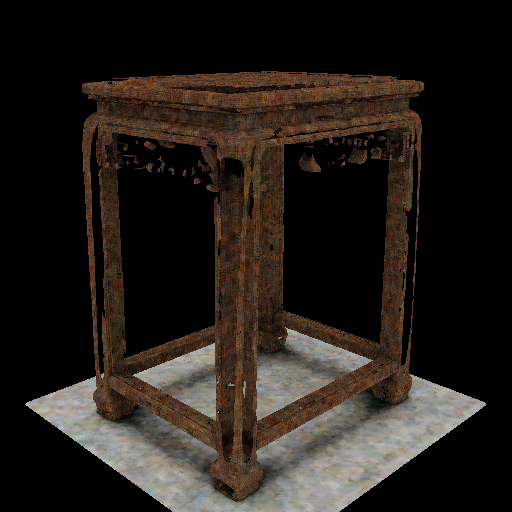
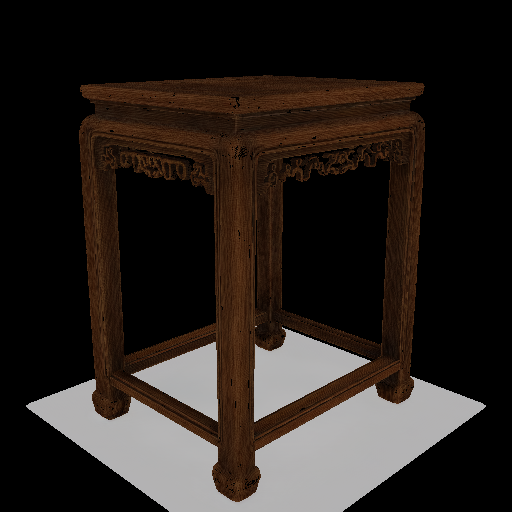

# Issue 4: faster inference with native sampling

The recommended quality profile keeps all native Euler evaluations and uses
[SageAttention](https://github.com/thu-ml/SageAttention) for self-attention in the
final shape and texture flow models. Coarse cascade stages, cross-attention,
sampler schedules, guidance and model weights retain their native configuration.

This profile addresses the quality problem by avoiding velocity forecasting.
It accelerates work inside each fresh evaluation. It does not make the original
aggressive velocity cache lossless, and it does not reproduce that cache's 58s
latency. The goal here is near-native fidelity with lower latency than native
TRELLIS.2.

## Why the original port lost quality

The source audit compared:

- [Microsoft TRELLIS](https://github.com/microsoft/TRELLIS/blob/193e0502b5cb3eb5997ec457d5340e95d09b158e/trellis/pipelines/samplers/flow_euler.py).
- [Fast-TRELLIS](https://github.com/wlfeng0509/Fast-SAM3D/blob/eb6f0821859a99d926a548518b6c19893cccffd6/Fast-TRELLIS/trellis/pipelines/samplers/flow_euler.py).
- [Microsoft TRELLIS.2](https://github.com/microsoft/TRELLIS.2/blob/75fbf0183001ed9876c8dbb35de6b68552ee08bd/trellis2/pipelines/samplers/flow_euler.py).

The Euler velocity conversion agrees between the native implementations. The
`v_new = x_new + (v_anchor - x_anchor)` reuse rule and its gain/history proxy are
inherited from Fast-TRELLIS; there is no new sign error to reverse. That rule
assumes a particular state response and does not bound explicit time variation.

TRELLIS.2 also introduces state-dependent guidance rescaling and separate shape
and texture flows. Caching the final guided velocity skips fresh rescaling.
Shape approximation affects the latent that conditions texture: a mesh can score
well geometrically while its texture conditioning still changes substantially.
Refreshing guidance branches separately improved geometry in an ablation, but
did not recover the complete native result. Sparse-structure forecasting could
also increase downstream token counts and decoding work, losing the intended
speed benefit. See the [full investigation](ISSUE-4-GPU-INVESTIGATION.md).

The earlier short-schedule safeguard restored full evaluation, giving up cache
speed. Separately, the port computed FFT scores on cascade runs that never used
them and retained scores across pipeline reuse. Commit `397ac66` bypasses those
unused scores and clears prior-run scores. The focused check preserves occupancy
coordinates and RNG state and covers sequential 512/cascade runs.

## Measured results

Uploaded stool input, `1024_cascade`, all 12 native steps, two seeds. These are
paired runs on the available RTX 4060 8GB Windows compatibility runtime described
in the investigation: Python 3.11.9, PyTorch 2.8.0+cu128, FP16 conversion and
FlashAttention 2.8.3. Model revision `af44b45f2e35` and preprocessing are shared.
These are not measurements on the reporter's RTX 3090/SDPA environment.

| Seed | Profile | Sampler seconds | Generation seconds | Geometry Fscore@.005 | Whole/crop texture PSNR |
|---|---|---:|---:|---:|---:|
| 42 | Native TRELLIS.2 | 195.19 | 271.24 | reference | repeat-render 33.25/34.24 dB |
| 42 | Sage self-attention, native sampling | 153.99 | 227.67 | 1.000000 | 32.76/33.46 dB |
| 43 | Native TRELLIS.2 | 199.36 | 289.67 | reference | reference |
| 43 | Sage self-attention, native sampling | 156.44 | 243.83 | .999915 | 32.03/31.91 dB |

Sampling was about 21% faster in both pairs; generation was about 16% faster.
Generation includes lazy stage loading and raw decoding, but excludes initial
image preprocessing, rendering, GLB export and remeshing. CUDA synchronization
surrounds stage timing. This is one image with two seeds, not a broad benchmark
or a claim of performance on another GPU.

Fscore compares sampled raw vertices against the paired native mesh without
alignment. It measures reference fidelity, not ground-truth accuracy or bitwise
geometry equality. Six fixed-camera base-color views use 60k-face render proxies.
The crop is the upper 65% of the frame on common geometry masks, not semantic
segmentation. Decimation varies slightly even for identical native outputs;
the seed42 native repeat-render comparison is shown explicitly. Both whole-view
and crop scores are retained.

Decoded material attributes were also compared at exact shared voxel coordinates:

| Seed | Shared native coordinates | Base-color RMSE | Metallic RMSE | Roughness RMSE | Alpha RMSE |
|---|---:|---:|---:|---:|---:|
| 42 | 96.92% | .00363 | .02703 | .01499 | .00449 |
| 43 | 97.10% | .00462 | .00572 | .00738 | .01722 |

These comparisons exclude unshared coordinates and use stored PBR channel units.
Local maximum differences can be larger; see the
[complete material-attribute results](issue-4-material-attributes.json).
The profile is not lossless even where rendered fidelity is close to native.

| Native TRELLIS.2 | Previous experimental cache | Sage profile |
|---|---|---|
|  |  |  |

Images are the same seed42 camera and rendering setup. The previous cache took
58.37s in sampling but scored .359 geometry Fscore and 15.41/19.75dB texture
PSNR. Its latency is not a native-quality baseline.

## Implementation and checks

`pipeline.enable_sage_attention()` selects only final-flow self-attention.
Reconfiguring a reused pipeline clears Sage selections from former final stages
that become coarse stages. Passing `mode=None` restores native self-attention.
The implementation sets per-module backend choices; it does not replace global
imports or alter checkpoint parameters. The CLI profile explicitly selects
native samplers, so every velocity and guidance rescale is freshly evaluated.

Sage uses approximate low-precision attention internally. The default `auto`
dispatch uses SageAttention2++ on the tested Ada GPU. `fp16pv` uses an FP16 value
product with FP32 accumulation. The latter was tested on real texture inference;
the complete two-seed table above uses `auto`.

Checks completed:

- CPU dense and ragged QKV dispatch, sample isolation, native default behavior,
  model weights, cross-attention isolation and pipeline reconfiguration.
- The same packing checks using real CUDA Sage kernels for both precision modes.
- Public implementation texture latents exactly matched the experimental Sage
  adapter (equal coordinates and maximum feature difference zero).
- Complete raw decoding and six-view evaluation on the uploaded image for seeds
  42 and 43; seed43 used the public implementation.
- A complete public-implementation sampler rerun at seed42 matched both the
  shape and texture latents from the experimental profile exactly (coordinates
  equal and maximum feature difference zero). Its sampling time was154.14s.

JIT caches were warmed during the kernel/stage checks. First-use compilation can
add startup time. The public seed42 repeat reused its identical previously
decoded outputs rather than repeating decoding/rendering.

CPU checks intentionally substitute PyTorch attention for the optional Sage
package to exercise dispatch and packing. CUDA checks exercise the real kernels:

```bash
python tools/verify_cascade_scores.py
python tools/verify_sage_attention.py
python tools/verify_sage_attention.py --device cuda
```

## Usage and installation

In an existing supported CUDA installation, follow the
[upstream SageAttention installation instructions](https://github.com/thu-ml/SageAttention#installation):

```bash
pip install sageattention==2.2.0 --no-build-isolation
python example_faster.py --attention sage --image path/to/input.png
```

For API usage, load the native pretrained pipeline, call `pipeline.cuda()` as a
separate statement, then `pipeline.enable_sage_attention(mode="auto")`. This
pipeline's `cuda()` method returns `None`; chaining it into assignment is invalid.
The kernel-selection method preserves a caller's sampler configuration; use the
native samplers for this profile. The CLI configures that profile explicitly.

The Windows validation used the matching
[community PyTorch 2.8/cu128 build](https://github.com/woct0rdho/SageAttention/releases/tag/v2.2.0-windows.post3),
`sageattention-2.2.0+cu128torch2.8.0.post3-cp39-abi3-win_amd64.whl`, SHA256
`7dabcd00e63229b28f046c5a69ec37cf4756afb375dbadd1975dadec045ae21c`.
The isolated embedded Python initially lacked development headers/import libs;
matching Python 3.11.9 headers/libs were added from the official Python NuGet
package after verifying its catalog SHA512. Existing development files were
preserved. No PyTorch upgrade or model-weight change was required.

The recommended profile still needs confirmation on the original RTX 3090
configuration. The original velocity cache remains an explicit experimental
option rather than a native-quality guarantee.
